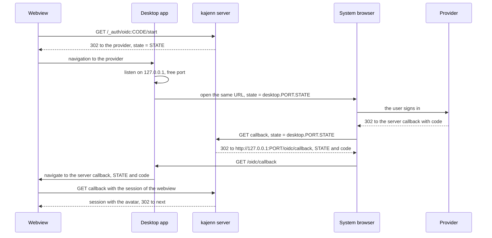

<!-- generated from desktop-sign-in.xml by xmldocs: do not edit, edit the XML -->

## Sign in from a desktop app through an OIDC provider
*Instruction booklet · booklet/desktop-sign-in · 2026-11-20*

### Purpose

How a desktop app whose interface is a webview on a kajenn server signs a user in through an OIDC provider of `_auth` (Keycloak, for example), why the sign-in runs in the system browser, what kajenn does and what the desktop app must do.

A source without a repository prefix is a path in the kajenn repository, read on 2026-11-20.

### Requirements

- A kajenn server with `_auth`, an OIDC provider declared in it, and `external_url` set.
- A desktop app able to stop a navigation of its webview, open a URL in the system browser and listen on `127.0.0.1`.

#### 1. What happens


*Sign-in of a desktop app through the system browser*

1. The webview asks `/_auth/oidc:<code>/start`. The server saves state, PKCE verifier and nonce in the session of the webview and answers 302 to the provider.
2. The desktop app stops that navigation, listens on `127.0.0.1` on a free port and opens the same URL in the system browser, with the `state` parameter rewritten as `desktop.<port>.<state>`.
3. The user signs in in the system browser. The provider sends the browser to the server callback.
4. The server recognises the desktop state and answers 302 to `http://127.0.0.1:<port>/oidc/callback` with the original `state` and the `code`, or the provider's `error`.
5. The desktop app sends its webview to the server callback with the original state and the code. The server completes the sign-in in the session of the webview and redirects to the `next` path.

The system browser never receives the login: the code is useless without the PKCE verifier, which stays in the session of the webview.

#### 2. What the desktop app must do

- Recognise the navigation to the provider's authorization endpoint by its own configuration. kajenn adds nothing to the authorization URL.
- Read the `state` of that URL; it is 43 characters of `A-Z a-z 0-9 _ -`.
- Listen on `127.0.0.1`, port 1024-65535, path `/oidc/callback`.
- On the request it receives, check that `state` is the original one, then navigate the webview to the server callback with the same `state` and `code`.

#### 3. Check the server side

```bash
# A desktop state answers 302 to 127.0.0.1:51001
STATE=$(printf 'A%.0s' $(seq 43))
curl -s -o /dev/null -D - "https://<external_url>/_auth/oidc:<code>/callback?state=desktop.51001.$STATE&code=probe" | grep -i -E '^HTTP|^location'

# A port below 1024 answers 400
curl -s -o /dev/null -w '%{http_code}\n' "https://<external_url>/_auth/oidc:<code>/callback?state=desktop.80.$STATE&code=probe"
```

### Verified facts

- `TEST` `src/kajenn/auth_app/oidc_method.py` · 2026-11-20 — A callback with state `desktop.<port>.<state>` and `code` answers 302 to `http://127.0.0.1:<port>/oidc/callback?state=<state>&code=<code>` with `Cache-Control: no-store` and `Referrer-Policy: no-referrer`, exchanges no code and attaches no avatar (`tests/auth_app/test_oidc.py`, `TestDesktopLogin`).
- `TEST` `src/kajenn/auth_app/oidc_method.py` · 2026-11-20 — The provider's `error` is passed back in place of `code`. A port outside 1024-65535, an original state that is not 43 characters of `A-Z a-z 0-9 _ -`, or neither `code` nor `error` answer 400.
- `TEST` `src/kajenn/auth_app/oidc_method.py` · 2026-11-20 — The webview sent to the callback with the relayed state and code completes the sign-in in its own session.
