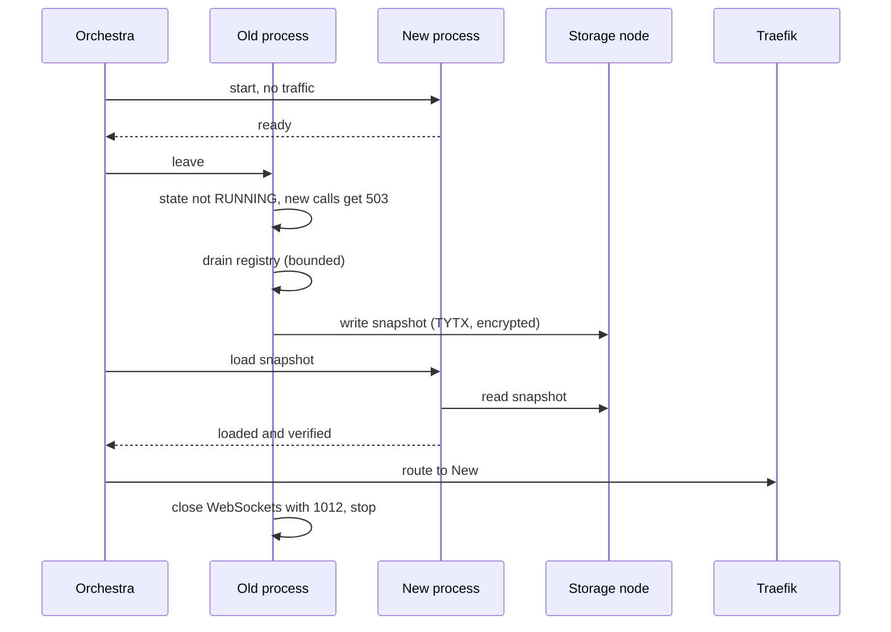

<!-- generated from update-handover-and-sessions.xml by xmldocs: do not edit, edit the XML -->

## Update handover and durable sessions
*Proposal · proposal/update-handover-and-sessions · 2026-11-19 · draft*

### Problem

An update of a kajenn application replaces its process. Everything the process keeps in memory is lost at that moment: the sessions, so every user signs in again, and the state shared by the pages, for example the chat of a meeting room.

The application this came from is Meetlot (kajenn-webrtc): one Kubernetes Deployment with one replica and `strategy: Recreate`. Each deploy signs everybody out and closes the PageStore WebSocket of every open page.

The same application needs session lifetimes that depend on where the user signed in: a desktop app should keep its user signed in for months, a browser on a shared computer for a couple of hours.

### Current state

#### kajenn today

- `READ` `src/kajenn/request_registry.py:15-34` · 2026-11-19 — `RequestRegistry` registers every operation on entry and drops it on exit: an http dispatch, a WSX message, a kbus frame, a task. It counts operations, not connections.
- `READ` `src/kajenn/request_registry.py:191` · 2026-11-19 — `await_drain(timeout)` waits for the in-flight set to empty and returns how many operations are still open when the timeout runs out.
- `READ` `src/kajenn/server.py:765-772` · 2026-11-19 — While the server state is not `RUNNING`, a new http call gets `503 Server restarting` with `Retry-After: 5`.
- `READ` `src/kajenn/lifespan.py:225-251` · 2026-11-19 — Shutdown turns the state, drains the registry for at most `SHUTDOWN_DRAIN_TIMEOUT_SECONDS` (10 s), then runs the `on_shutdown` hooks and closes the databases.
- `READ` `src/kajenn/websocket.py:301` · 2026-11-19 — `WebSocketRegistry` keeps the live sockets and the socket each page speaks on, and already accepts a page that reconnects on a new socket before the old one closes.
- `READ` `src/kajenn/session/session.py:134-138` · 2026-11-19 — A session expires after `ttl` seconds without requests: every request refreshes `last_access`.
- `READ` `src/kajenn/session/store.py:174-196` · 2026-11-19 — `MemorySessionStore.save_snapshot` and `load_snapshot` write and read one pickle of the session objects through `pathlib.Path`, outside the storage nodes.
- `READ` `src/kajenn/__main__.py:336` · 2026-11-19 — Only `kajenn serve <name>` arms the snapshot; a server built directly with `AsgiServer` has none.

### Proposed solution

#### 1. One process per application

- **must** — A kajenn application runs as one Kubernetes replica. Several processes are kajenn-orchestra's job. *(A kajenn process keeps state in memory; Kubernetes replicas would split it.)*

#### 2. Every file goes through a storage node

- **must** — Every read and write of a file goes through a genro-storage node of the server's `StorageManager`. A direct `pathlib` access is a bug. *(The deployment chooses where the data lives — pod disk, persistent volume, S3 — and the write can be encrypted.)*

#### 3. The update is a handover

1. The new process starts and gets ready, without traffic.
2. The old process turns its state: a new call gets `503` with `Retry-After`.
3. The old process drains its registry, with a time limit. At the limit the operations still open end with an explicit error.
4. The old process writes the snapshot of its durable state.
5. The new process loads the snapshot.
6. The route of Traefik moves from the old process to the new one.
7. The old process closes its WebSockets with code `1012 Service Restart` and stops.

The old process stays alive with its state until the new one is ready and verified. If the new one fails, the route does not move and the old process returns to `RUNNING`.

kajenn-orchestra drives the handover: it knows both processes and the storage.

*Handover between the old and the new process*

#### 4. Calls during the handover

A call that arrives while the old process is leaving is refused with `503` and `Retry-After`, as kajenn does today. The old process keeps no call waiting and never proxies.

- **must** — The Gramlot client transport repeats a call refused with `503` after `Retry-After`. One place, valid for every page.

#### 5. WebSockets are rebuilt, not moved

An open connection cannot move between processes. At the switch the old process closes it with `1012`; the client reconnects with the same `pageId`; the new process rebuilds the page state from the durable state.

- **must-not** — Put the volatile state of a single page in the snapshot. *(It keeps the snapshot small and independent of the pages' code.)*

#### 6. The snapshot

- Content: the durable state only — the sessions and the state shared by the pages of an application (for example the state of a meeting room).
- Format: plain data, lists and dicts, serialized as TYTX. TYTX keeps dates, decimals and bytes that plain JSON loses.
- Place: a storage node, written encrypted. The write is atomic: a temporary node, then a rename.

- **must-not** — Write pickled objects in a snapshot. *(Pickled objects break when a class changes between the old and the new release, and loading a tampered pickle runs code.)*
- **must** — A reader of the snapshot tolerates missing keys (default value) and ignores the keys it does not know. *(The old and the new process run different releases.)*

The snapshot is armed by the configuration of the site, not by the command that starts the server.

#### 7. Session lifetimes

*Lifetime without requests, renewed by every request*

| Where the user signed in | Lifetime |
|---|---|
| Desktop app | 90 days |
| Browser, with "Remember me" | 12 hours |
| Browser, without "Remember me" | 2 hours |

- The login method sets the lifetime of its session when it attaches the identity, through a public API of the session.
- The cookie lasts longer than any session: the server is the only judge of expiry.
- An administrator can close the sessions of a user.
- The groups of the identity provider are read again periodically, not only at sign-in: a user removed from an administrators' group loses the rights within that period, not at the end of the session.

### Decisions

- **d-refuse** `decided` — What happens to a call that arrives during the handover?
   1. **Refused with 503 and Retry-After, repeated by the client**
   2. **Held by the old process and forwarded to the new one**
   → Choice: **Refused with 503 and Retry-After, repeated by the client** (GP, 2026-11-19) — No call stays hanging in the old process; kajenn already answers so.
- **d-format** `decided` — Which format does the snapshot use?
   1. **Plain data in TYTX, encrypted on a storage node**
   2. **Pickled session objects**
   → Choice: **Plain data in TYTX, encrypted on a storage node** (GP, 2026-11-19) — No class versions between releases, types kept, no code run when reading.
- **d-replicas** `decided` — Who runs several processes of one application?
   1. **kajenn-orchestra**
   2. **Kubernetes replicas**
   → Choice: **kajenn-orchestra** (GP, 2026-11-19) — Kubernetes replicas would split the state a kajenn process keeps in memory.
- **d-drain-limit** `open` — How long does the old process wait for the open operations, and what does it answer them at the limit?
- **d-groups-period** `open` — How often are the groups of the identity provider read again for a long session?

### Consequences

- An update signs nobody out and leaves no gap in the answers; open pages reconnect.
- A crash still loses what changed after the last snapshot: accepted.
- The deployment chooses where the snapshot lives without touching the application.
- The Gramlot client gains two behaviours used by every page: repeat on `503`, reconnect on `1012`.
